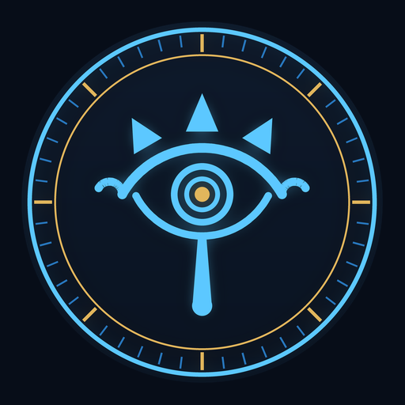
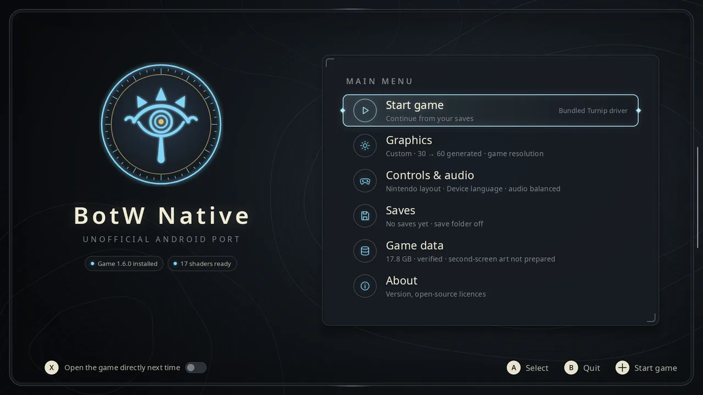
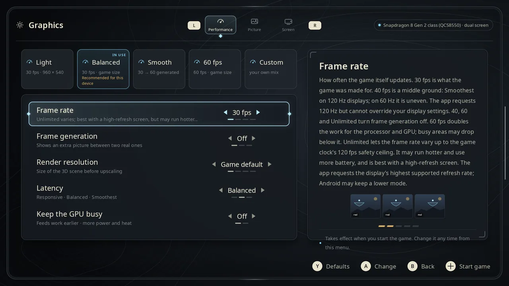
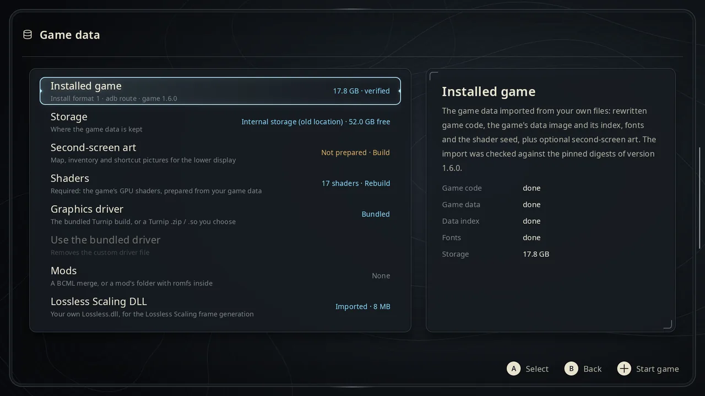
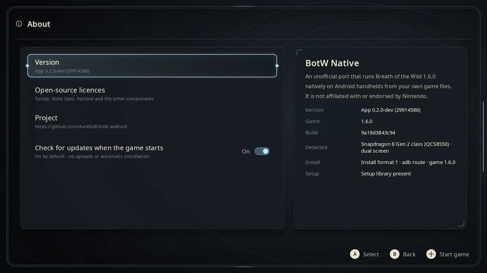
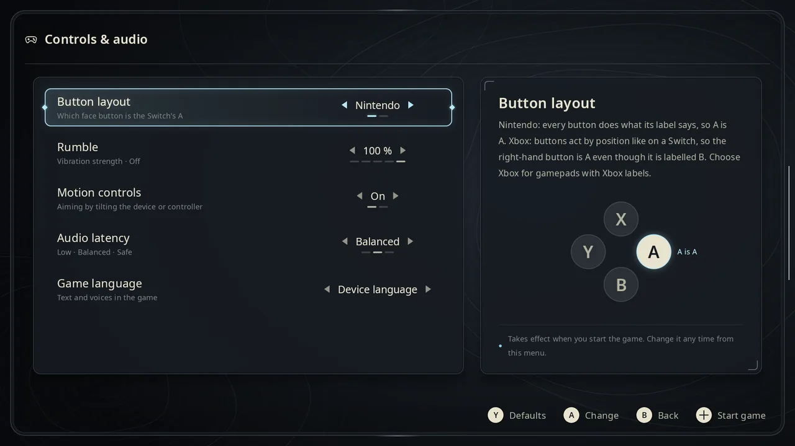

# BotW Native for Android

**BotW Native** (`io.github.p1r4n351.botw`) runs **The Legend of Zelda: Breath of the Wild 1.6.0** natively on Android
handhelds with a Qualcomm Adreno GPU. It is not an emulator: the game's own code is prepared once to run directly on
the device's processor, and its graphics are drawn by a bundled Vulkan driver. It is built on
[TotK Native](https://github.com/AurelioB/totk-android), the native Tears of the Kingdom port, and shares its runtime,
graphics layer and controller-friendly menu. The app contains **no game files**: you supply your own dump of the game.

  
  
  
  

**Experimental.** BotW Native was developed and tested on one device, an AYN Thor, and has been played through the
opening, the Great Plateau and the menus. Setup on the device is not ported yet: the game folder is prepared by hand
(see [Install and first setup](#install-and-first-setup)).

The same code base also builds **TotK Native (fork)**, the Tears of the Kingdom app with this fork's additions; its guide
is [docs/totk-native.md](docs/totk-native.md).

- [Nintendo, if you're reading this](#nintendo-if-youre-reading-this)
- [Features](#features)
- [Requirements](#requirements)
- [Install and first setup](#install-and-first-setup)
- [Performance](#performance)
- [Settings](#settings)
- [Mods, saves and storage](#mods-saves-and-storage)
- [Dual-screen companion](#dual-screen-companion)
- [Stick LEDs (Bifrost)](#stick-leds-bifrost)
- [Known limitations](#known-limitations)
- [FAQ and troubleshooting](#faq-and-troubleshooting)
- [For developers](#for-developers)
- [Support](#support) · [Credits](#credits) · [License](#license) · [Legal](#legal)

What is ported, what differs from the Tears of the Kingdom build and what is untested:
[games/totk/android/BOTW.md](games/totk/android/BOTW.md). Findings with their evidence: [docs/research/](docs/research/README.md).

## Nintendo, if you're reading this

This is the game you promised us, not the one you delivered.

Many of us will never forget waiting seven years for an original Zelda game on the Wii U, only to be handed a port of
a Switch game and a pat on the ass on the way out the door. 水臭い野郎どもめ。

E3の時の光景はしっかり覚えている。青沼さんたちが見せてくれたものは忘れない。お前らは我らを裏切ったな。

The AYN Thor is arguably a spiritual successor to the 3DS, and the direction Nintendo would have taken if it had had
any stones. そうだ、玉なしだって言ったんだよ。

In a timeline where Nintendo did things properly and didn't hate its fans, it would have released something more like
this, honouring what it showed off and promised.

Nintendo, it is our sincere hope that people choose our experience over yours, and that you learn a few lessons from us
about making good on your promises.

Oh, and you can be sure we'll do the same to the Switch 2 versions of your games at some point.

文句があるなら面と向かって言え。かかってこいや。

## Features

- **Runs the game natively** at 30 fps on the AYN Thor, with the bundled Mesa Turnip driver.
- **Add-on content**: the Master Trials and the Champions' Ballad (DLC 3.0) mount from your own extracted images.
- **Mods**: RomFS mods (a BCML merge or one mod's folder or zip) and IPS patches of the game's `main`, imported in the
  menu. Tested with the Second Wind mod's Switch merge.
- **A pre-game menu** made for controllers, shared with TotK Native: *Start game*, *Graphics*, *Controls & audio*,
  *Saves*, *Game data* and *About*, in a Sheikah-blue theme. **+** starts the game from any screen.
- **Frame generation** with **Lossless Scaling** from your own `Lossless.dll`, or the app's own interpolation
  (experimental).
- **Dual-screen companion** on the AYN Thor: the Eden Duo Sheikah Slate pages on the second screen.
- **Stick LEDs** that follow the Sheikah Slate through the [Bifrost](https://github.com/KuriGohan-Kamehameha/Bifrost)
  LED app.
- **Fast start**: the mod overlay is verified once and remembered, so later starts skip re-checking it.

## Requirements

- **Android 13 or newer**, 64-bit (arm64).
- **A Qualcomm Snapdragon chip with an Adreno GPU.** The game draws through the Mesa **Turnip** Vulkan driver bundled in
  the app, which supports Adreno GPUs only.
- **Storage**: about **20 GB** for the game image (base game and update merged), plus the optional DLC images and the
  prepared shader seed (about 1 GB).
- **Your own, legally dumped copy of the game, version 1.6.0** (title `01007EF00011E000`, `main` build id
  `8E9978D50BDD20B4C8395A106C27FFDE`), made from a cartridge or eShop purchase you own, on your own Switch: the base
  game, the 1.6.0 update and, if you want them, the DLC, with the keys of your own console to decrypt them.
- **A computer** with Python 3 to prepare the game folder (see below), and `adb` to copy it to the device.

Tested devices:

| Device | Chip | GPU | Android | Second screen |
|---|---|---|---|---|
| AYN Thor | QCS8550 | Adreno 740 | 13 | built in, companion on |

## Install and first setup

1. Download the latest `BotW-Native-<version>.apk` from the [Releases page](https://github.com/P1R4N351/botw-android/releases)
   and install it (allow installs from your browser or file manager).
2. Prepare the game folder on a computer from your own dump. The on-device setup of the menu does not know this game
   yet, so this is the developer route:
   1. Rewrite the three code modules (`main`, `subsdk0`, `sdk`) for Android with `patch_nso.py`, and build the runtime
      tables (`scripts/prepare_runtime.py --version botw160`).
   2. Merge the base game and the 1.6.0 update into one RomFS image and index it; extract the DLC images the same way
      if you have them.
   3. Build the shader seed from the game files (`scripts/prepare_botw_seed.py`).
3. Copy the folder to the app's game folder, `/sdcard/Android/data/io.github.p1r4n351.botw/files`, with `install.json`
   last, and make the files readable by the app.
4. Open **BotW Native** and press **+** to play.

Every file, its place and the exact commands: [BOTW.md → Putting the game on a device](games/totk/android/BOTW.md#putting-the-game-on-a-device-developer-route).
Nothing is uploaded: your files stay on your computer and your device.

## Performance

Not measured with the method of the Tears of the Kingdom app yet. On the AYN Thor with the default settings, the game
runs at its own 30 fps on the Great Plateau and in the menus. Measuring it is on the list:
[docs/benchmarks/](docs/benchmarks/LEDGER.md) has the method.

## Settings

The menu is the Tears of the Kingdom app's: every option, its explanation and its controls are described in
[docs/totk-native.md → Settings](docs/totk-native.md#settings). On the menu: **A** changes, **◀ ▶** adjust, **L** /
**R** switch tabs, **Y** restores the current tab's defaults for your device, **B** goes back, **+** starts the game.

The options were written for Tears of the Kingdom and most are untested with Breath of the Wild. What differs here:

| Option | In BotW Native |
|---|---|
| Frame rate | 30 fps is tested; 40 and 60 fps are untested |
| Frame generation | *Lossless Scaling* uses the LSFG engine from your own `Lossless.dll`, imported once under *Game data → Lossless Scaling DLL*; the app does not include it |
| Console mode | Handheld is tested; Docked is untested |
| Second screen | The Eden Duo companion (below) |

Developer switches that differ from Tears of the Kingdom (in `totk.env`, see [docs/developer-settings.md](docs/developer-settings.md)):

| Switch | Default here | What it does |
|---|---|---|
| `TOTK_XLATE_WAIT_MS` | 4000 | A draw waits up to this long for a shader still being translated. The game draws some images only once, so a skipped draw would stay wrong |
| `TOTK_VK_PIPE_SYNC` | 1 | A draw waits for its pipeline to finish compiling, for the same reason |
| `TOTK_MOVIE_PACE` | 0 | Movie pacing off: with it on, the game never got past the tower-activation cutscene |
| `TOTK_BOTW_TINY_WB` | on | Writes the game's one-pixel water colour renderings back at once, so water has its real colour; `0` turns it off |

## Mods, saves and storage

- **Mods**: *Game data → Mods* imports a [BCML](https://github.com/NiceneNerd/BCML) merge or one mod's folder or zip
  with `romfs` inside, into the app's private storage (`mods/botw160`). RomFS files and IPS patches of `main`
  (`exefs/8E9978D50BDD20B4C8395A106C27FFDE.ips`) are used; code modules are not loaded. A mod folder can also be given
  with a `manifest.tsv` through `TOTK_ROMFS_MODS`. Mods that change DLC files (BCML's `01007EF00011F001` folder) are
  not imported by the menu yet. See [docs/mods.md](docs/mods.md).
- **Saves** stay in the app's private storage. *Saves* exports and imports them as in the Tears of the Kingdom app,
  tagged with this game's title id; this has not been tried with BotW saves yet, so keep your own copies.
- **Uninstalling the app removes your saves**: export them first.
- **Game data** lives in the app's folder on internal storage (`/sdcard/Android/data/io.github.p1r4n351.botw/files`).

## Dual-screen companion

On the AYN Thor, the second screen shows the **Eden Duo** companion's Sheikah Slate pages for Breath of the Wild,
drawn by the Eden Duo companion runtime built into the app (`libduo_host.so`, GPL-3.0). The page dims during cutscenes
and dialogue, as in Eden Duo. Touch on the second screen and the companion's item actions are not finished yet.

The Tears of the Kingdom app keeps its own map and inventory screen and does not include the Eden Duo code. Both screens
read one shared game state; how the two are being brought onto one common layer: [docs/companion-waist.md](docs/companion-waist.md).

## Stick LEDs (Bifrost)

With the [Bifrost](https://github.com/KuriGohan-Kamehameha/Bifrost) LED app installed, the AYN Thor's stick rings
follow the Sheikah Slate: its blue glow breathing, orange until the slate is yours, a dip when you touch the second
screen or open the menu, a red stutter when hearts run low. To set it up:

1. Install Bifrost and keep its LED service running.
2. In Bifrost's settings, turn on **Allow third-party LED control**.
3. Optionally, install the **Zelda Android** plugin from Bifrost's Plugin Store. It adds the Sheikah Slate and Purah
   Pad presets and switches to them when either game is in front.

Each stick ring can only show one colour at a time on stock firmware; why: [docs/research/thor-per-led.md](docs/research/thor-per-led.md).

## Known limitations

- Game version **1.6.0** only. No online features or amiibo.
- **No on-device setup yet**: the game folder is prepared on a computer.
- Tested on the AYN Thor only; other Adreno devices are untested.
- The Graphics options are untested beyond the defaults (30 fps, handheld).
- Shaders the prepared seed does not hold are translated while playing; the first draw waits for them (up to 4 s), so a
  new place can pause briefly the first time.
- Around some shrines, an older picture can stay blended over the scene in dialogue and cutscenes (depth of field); the
  cause is not found yet: [docs/research/botw-graphics.md](docs/research/botw-graphics.md).
- Saves have not been tried with the menu's save manager.
- Saves are removed with the app: export them first. A developer build cannot be updated in place by a release build:
  they are signed with different keys.

## FAQ and troubleshooting

**Water looks blue, pink, yellow or purple.** Fixed in 0.2.0: the game read its water colours before the GPU had
written them. If it comes back, check that `TOTK_BOTW_TINY_WB` is not set to `0` in `totk.env`.

**The start screen or other images look wrong, or draw nothing.** A shader was still being translated when it was first
needed. The seed pack (`shaders/botw160/seed.vkpack`) avoids this; check that it is in place and that no empty seed
folder shadows it.

**The game stops at the tower-activation cutscene.** Movie pacing must be off (`TOTK_MOVIE_PACE=0`, the default here).

**The game takes 20 seconds or more of black screen to start.** A RomFS mod overlay is being verified. This happens once
after the mods change; later starts skip it.

**The stick LEDs do not change.** Bifrost's LED service must be running and *Allow third-party LED control* on.

**The menu says "The game stopped".** The graphics driver lost the GPU or the game hit a fatal error. Your saves are
kept; progress since the last save is lost. The details are in `totk.log` in the game folder; please include it in a
bug report.

## For developers

- [MAINTENANCE.md](MAINTENANCE.md): one branch builds both apps; the per-game variables (`games/games.toml`), building,
  testing and syncing with upstream.
- [games/totk/android/BOTW.md](games/totk/android/BOTW.md): what is ported for Breath of the Wild, and the game folder.
- [docs/research/](docs/research/README.md): findings with their evidence (graphics, LEDs, stamina and cutscene
  signals, per-LED control).
- [docs/companion-waist.md](docs/companion-waist.md): the second-screen ledger.
- [docs/architecture.md](docs/architecture.md), [docs/building.md](docs/building.md),
  [docs/developer-settings.md](docs/developer-settings.md): how the port works, building and `totk.env` switches.
- [games/totk/android/README.md](games/totk/android/README.md), [APP.md](games/totk/android/APP.md),
  [VULKAN.md](games/totk/android/VULKAN.md), [DEBUGGING.md](games/totk/android/DEBUGGING.md): the full developer notes.

Build either app: `tools/build_app.sh botw {dev,release}` or `tools/build_app.sh totk fork`; test both with
`tools/check_all.sh`.

## Support

If this work is useful to you, donations are gratefully accepted:

- Bitcoin: `bc1q4a3lqcg87rvw7vxulausdqhhuwkwwa6w6v4mxx`

## Credits

This project builds on the work of others:

- **[totk-android](https://github.com/AurelioB/totk-android)** by AurelioB (MIT): the native Tears of the Kingdom
  Android port this fork is based on, with its runtime, Vulkan backend, app and menu.
- **[MacNativeGames](https://github.com/ly05010419/MacNativeGames)** by ly05010419 and its contributors (MIT): the
  native port for Apple silicon, including its Breath of the Wild runtime differences, game patches, shader list and
  seed script this port takes over.
- **[kitcatkode/MacNativeGames](https://github.com/kitcatkode/MacNativeGames)**, **[D2R Mobile](https://github.com/jhaizhou-ops/d2r-mobile)**
  (MIT), **Ryujinx** (MIT), **[Mesa](https://mesa3d.org) Turnip** (MIT) and the other components credited in
  [docs/totk-native.md](docs/totk-native.md#credits).
- **Eden Duo** and its companions (GPL-3.0): the second-screen companion runtime and its Breath of the Wild pages
  (`games/totk/duo`).
- **[Bifrost](https://github.com/KuriGohan-Kamehameha/Bifrost)** (GPL-3.0): the stick LED app the LED bridge talks to.
- The decompilation and research communities whose notes these projects build on.

Every bundled component, its version and its licence are listed in [THIRD_PARTY_NOTICES.md](THIRD_PARTY_NOTICES.md)
and shown in the app under *About → Open-source licences*.

## License

MIT (see [LICENSE](LICENSE)), except the Eden Duo companion integration under `games/totk/duo`, which is GPL-3.0; the
BotW Native APK, which includes it, is distributed under GPL-3.0-or-later. Third-party code keeps its own license:
[THIRD_PARTY_NOTICES.md](THIRD_PARTY_NOTICES.md).

## Legal

**You must own the game.** Use this project only with a copy of The Legend of Zelda: Breath of the Wild (and its DLC)
that you bought, and with keys and system files dumped from your own Nintendo Switch. This is an independent,
non-commercial project. It is not affiliated with, endorsed by, or sponsored by Nintendo. The Legend of Zelda, Breath of
the Wild, Tears of the Kingdom and Nintendo Switch are trademarks of Nintendo.

The repository and the APKs contain no game content and distribute none: no game program, art, text, audio, shaders or
keys, and they do not help to obtain them. Everything the game needs is made from your own files. What the repository
does hold is the information needed to make the port work: the patch code, the addresses and hashes used to check your
files, and the shader lists, which name shaders and bind states but contain no shader code. The game data you build is
for your own use only; do not share it.
